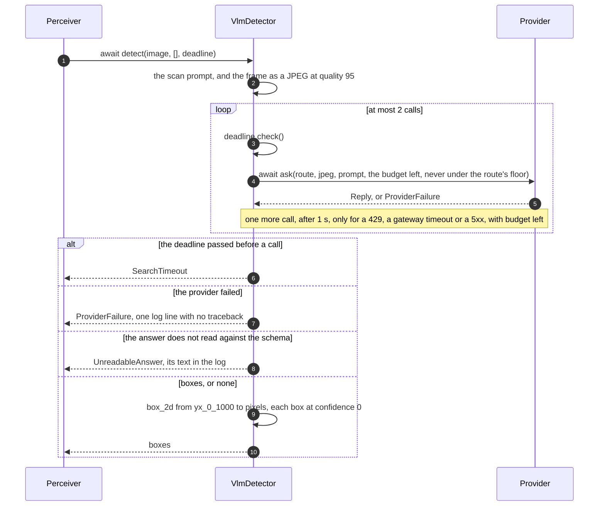

# vlm_router_brain

A brain whose models are hosted vision-language models, reached over the
network through [any-llm](https://github.com/mozilla-ai/any-llm). It serves
`item_perception:v1` and `item_manipulation:v1` as every brain does, and
`brain_model:v1`, which names the model of each role and switches one while
the brain runs. The contract rules, the robot, the camera geometry and the
goal loops are [brain_core](https://github.com/Peppy-bot/public-peppy-libs/tree/main/brain_core)'s;
this node brings the catalog of models, the detector that asks them, and
the keys.

It needs the network and a key, and no GPU.

## The catalog

`src/vlm_router_brain/catalog.json` lists the models the brain can run.
Each has a name of the node's own, the one `get_model`, `list_models` and
`switch_model` use, and one or more routes: a provider and that provider's
model id, with the settings the model was tested with.

| Model | Roles | Route |
|---|---|---|
| `gemini-robotics-er-2-preview` | perception | `gemini:gemini-robotics-er-2-preview` |
| `gemini-4-argon` | perception | `openrouter:google/gemini-4-argon` |
| `claude-opus-5.5` | perception | `openrouter:anthropic/claude-opus-5.5` |
| `gpt-6-astra` | perception | `openrouter:openai/gpt-6-astra` |

Every route asks for `reasoning_effort: "medium"`, and a call never gets
less than 10 s. A model is in the catalog once it returned correct boxes for
a Waldo chest frame through the node's prompt and schema: one question, "Find
the mustard bottle", one box at an IoU of 0.94 or more with the frame's
ground truth, in 3.3 to 4.9 s. Adding a model is an entry in this file: a
name, `"roles": ["perception"]`, `"coordinates": "yx_0_1000"` and its routes.
A catalog the node cannot read stops it at its start, naming the entry and
the field.

Both roles also accept `none`, the role's missing model: its goals are
refused naming it, a search with `precondition_failed`. Manipulation runs
a model built into the node, `scripted`, its default, or `none`, which
refuses `grab_item`, `drop_item` and `place_item` in their result with
`no manipulation model: manipulation_model is 'none'`, or a catalog model
that serves manipulation, which runs the scripted grab with an alignment
step the model answers (below). Every shipped model serves both roles:
each passed the real-call check of the alignment on 2026-10-24 (a cube 45
degrees off the jaws, one `move` with `roll_deg` 45 or 37). A catalog
model is never named `none` or `scripted`.

## The scripted manipulator

`scripted` is brain_core's `ScriptedManipulator` on its `CentreProposer`, and
makes no model call. A `grab_item` takes the item's seen point lowered 2.5 cm
(a grab by pose takes the pose itself), checks with the backbone's
`check_arm_move` that the pre-grasp point 7.5 cm above, the grasp point and
the lifted point 7.5 cm above all plan, trying the gripper pointing down at 8
rolls (a grab by pose with an orientation tries that one alone), then opens,
reaches, closes with the goal's `max_effort` and lifts. It opens the jaws as
wide as the item and 1.5 cm on each side, fully for an item of no known width.
It judges the hold
twice: from the close's `final_opening`, below 0.05 of which the grab fails
with `closed on nothing`, then from the first `limb_states` snapshot captured
after the lift, which it waits up to 1 s for; below 0.05, or more than 0.05
below the close's opening (jaws that lose the item close further), the grab
fails with `slipped while lifting`. A grab
that fails once the descent was sent first opens the gripper and moves the
arm straight back up to the pre-grasp point, unless a stop ended the step.
`drop_item` opens the gripper where it is; `place_item` carries the item to
7.5 cm above the pose, lowers it to the pose and opens there, or where the
item comes to rest on something on the way, and climbs back to 7.5 cm above. Every move goes through the
backbone that the `limb_motion` slot binds, and the `limb_state` slot gives
the measured openings and grasp points, so the launcher binds both to the
robot's backbone. Each arm move completes once the backbone has measured the
grasp point within 2 cm and 0.15 rad of its goal, and fails with `timeout`
when it is still outside them 2 s after the planned end of the motion: the
brain waits for no arrival of its own. When a placed item comes to rest on
something on the way down, the arm stops short and its move fails so; the
brain reads where the arm stopped from `limb_states`.

Known limitation: an abort while the arm climbs back after a `place_item`
released the item leaves the held flag set, though the jaws are open and the
item is down; `get_state`'s gripper opening shows the open jaws.

## The alignment step

With a catalog model as `manipulation_model`, the grab is the scripted one
with one more step between the move to the pre-grasp point and the descent:
the model looks and corrects (this node's `ModelAligner` over its
`RouterStepModel`, both in `manipulators/vlm`). Each step, at most 5, the
model gets the picture of the wrist camera of the gripper's arm, captured
after the arm settled, the chest picture, and the state as text (where the
grasp point stands against the item's seen centre, how high above the close,
the line the jaws close along, the jaws' opening, and where the robot's +x and
+y point in each picture, as clock hours), and answers one JSON object: `move`
(dx, dy in centimetres and roll_deg about the vertical, counter-clockwise seen
from above, at the same height), `ready` (go down, close with the goal's
`max_effort`, lift) or `give_up`. The code holds the limits: a step moves at
most 3 cm and turns at most 90 degrees, the gripper stays within 10 cm of the
item's seen centre, the height never changes, and the backbone must have a
plan for the new pre-grasp, grasp and lifted points before the move is sent. A
step over a limit, or one with no plan, or an answer the loop cannot read,
moves nothing, counts, and the model reads why in its next step. The schema of
the answer is one flat JSON object with `"strict": false`, the shape every
route accepts. A model that gives up, runs out of steps or has a move stopped
ends the grab before the descent, so nothing retreats. Each step leaves two
log lines: the call's route, tokens and latency, and the answer with what came
of it. The wrist cameras come through the `wrist_cameras` slot, and the
`wrist_cameras` parameter names each arm's camera; an arm without one cannot
be aligned, and such a grab fails before it moves, naming the arm.

A `place_item` whose jaws stand closed on air (the item slipped since the
grab) is refused before any move, naming it; a `drop_item` then lets the brain
forget the item. A `place_item` with the same model gets the same step above
the spot the held item goes to: the model centres the held item over the
container or the free patch the target point is in, within 10 cm of that point
(a container that already holds items is still the spot: the item may rest on
them), and `ready` lowers the item until it rests or the point is reached,
opens and climbs back. An arm the backbone stops short on the way down,
anywhere from the pre-place point down and within 5 cm of the line down, has
set the item on what is under it (a tall fruit meets a bowl's floor well above
the target; a fruit set on another slides off its top by a few centimetres),
and the place opens there.

## Keys

The node reads the key of a route from its own environment and from nowhere
else: `GEMINI_API_KEY` for `gemini`, `OPENROUTER_API_KEY` for `openrouter`. A
model runs on the first of its routes whose key is set. A starting model with
no keyed route stops the node, and a switch to one fails with
`resource_unavailable`, both naming the variables. No key is a parameter, and none is logged. A provider message
that holds the route's key shows `***` in its place.

`peppy stack launch` passes the launching shell's environment to the nodes it
starts on that machine, so a local launch reads the key the shell exports:

```sh
export GEMINI_API_KEY=...
peppy stack launch simulation_mcp --join openarm_sim:alpha --with alpha.vlm_router_brain
```

## What a search asks

A search asks one question with one picture: the colour frame at its full
resolution as a JPEG at quality 95. The question depends on the search: an
`identify_item` names one item ("Find the mustard bottle"), and `scan_items`,
or an `identify_item` with an empty description, asks for every object on
the table in the model's own words. Each answer is asked for, and read
against, one schema:

```json
{"boxes": [{"label": "the mustard bottle", "box_2d": [462, 312, 630, 382]}]}
```

`box_2d` is `[y_min, x_min, y_max, x_max]` normalised to 0-1000, and
`{"boxes": []}` means nothing asked for is visible, and an `identify_item`
then fails with `not_found`. An answer of another shape fails the search with
`attempt_failed`, `the model's answer could not be read`, and its text goes
to the log. A hosted model gives no confidence, so every item reports 0.

## Every search keeps a deadline

`timeout_s` is the search's budget, 30 s when zero. A call gets the budget
left, never under the route's `min_call_timeout_s` (10 s for every route), and
the model's provider ends a call with a gateway timeout when the model has
not answered within that. A call that comes back with a 429, a gateway timeout
or a 5xx is asked again once, after 1 s, when the budget has room for the
wait. Any other failure, a lost connection among them, fails the search with
`attempt_failed`, `<model> failed: <class>: <message>`, and the log keeps one
line with no traceback. A search whose budget is gone before a call fails
with `timeout`, `the search did not finish within <budget> s`. Each call logs
its route, its tokens and its latency.

## Switching a model

`switch_model {role: "perception", model: "claude-opus-5.5"}` makes that
model the perception model. The node asks the model once, a small grey
picture and a question whose answer is `{"boxes": []}`, and the switch fails
with `attempt_failed` and the provider's message when the model cannot be
reached or its answer does not read; the role then keeps its model. A switch
is refused with `rejected` for a role or a model the brain does not have, and
with `precondition_failed` while a goal of its role runs, naming it, and
while another switch of its role runs. A goal never sees its model change.
At the node's start the starting model makes no call: the first search is
its first call.

## How it works

brain_core's README draws the parts every brain shares, a goal from its
arrival to its end, and cancel, abort and shutdown. This node brings
`RouterModels`, its `ModelSource`, and `VlmDetector`, the perception model
of a catalog entry.

### switch_model

```mermaid
sequenceDiagram
    autonumber
    participant C as caller
    participant H as switch_model handler
    participant B as Brain.run_guarded
    participant Q as Sequencer
    participant M as Models
    participant RM as RouterModels
    participant P as Provider
    C->>H: goal with role and model
    H->>H: decide: the checks made before the goal is accepted
    alt the node is shutting down
        H-->>C: refused, precondition_failed
    else not a role of this brain
        H-->>C: refused, rejected: this brain runs no model for the role
    else the role does not take the model (RouterModels.offered)
        H-->>C: refused, rejected: the model is not a model of the role here, see list_models
    else another switch of the role runs, or the role's lane runs a goal
        H-->>C: refused, precondition_failed: switch_model is running for the role, or scan_items is running
    else accepted
        H->>B: run_guarded(ctx, no lane, "switch_model", body, ZERO, STATUS_ENDS)
        B->>Q: start(no lane, "switch_model")
        Q-->>B: Job
        B->>H: body(job)
        H->>M: switch(role, model, job): the checks of the decision again
        M->>M: mark the role as switching
        M->>RM: await prepare(entry), cut short by the job's cancel
        alt a model built into the node: none, or scripted for manipulation
            RM-->>M: its backend, no call made
            M->>M: the job's cancel is checked, then the lane, with no await before the set
            M->>M: the role's model is the new backend
            M-->>H: the model's name
            H-->>B: role and model
        else no route of the model has a key
            RM-->>B: Refusal, resource_unavailable, naming every key variable, no call made
        else a route has a key
            RM->>P: await ask(route, a small grey picture, the probe question, at least 30 s)
            alt the provider fails, or the answer does not read
                P-->>B: ProviderFailure or UnreadableAnswer, attempt_failed, the role keeps its model
            else the model answers
                RM-->>M: a VlmDetector on that route
                M->>M: the job's cancel is checked, then the lane, with no await before the set
                M->>M: the role's model is the new VlmDetector
                M-->>H: the model's name
                H-->>B: role and model
            end
        end
        M->>M: release the switching mark
        B-->>C: completed with role and model, failed with the kind, or cancelled; action_time the elapsed time
        B->>Q: finish(job)
    end
```

### scan_items, from the detector to the provider



## Parameters

| Parameter | Default | Meaning |
|---|---|---|
| `limbs` | required | Each arm with its gripper, `"left_arm:left_gripper,right_arm:right_gripper"` |
| `perception_model` | `gemini-robotics-er-2-preview` | A catalog model that serves perception, or `none` |
| `manipulation_model` | `scripted` | `scripted`, `none`, or a catalog model that serves manipulation, which aligns the scripted grab |
| `camera_name` | required | The camera the brain looks through, as the robot's `camera_mounts` names it |
| `wrist_cameras` | `left_arm:wrist_left,right_arm:wrist_right` | Each arm with the instance id of the wrist camera it carries; an arm not named has no wrist camera |

## Tests

`uv run --locked --with pytest pytest` runs the suite with no network and no
key: the catalog, the keys, the any-llm adapter against any-llm's own
exception classes, the parser, the detector, the alignment (its loop, the
aligner's guards and ends, the picture directions, the step model and its
probe), the switch against a scripted provider, and the whole node over the
wire under the generated harness, its camera and backbone mocked: a search, a
switch (a manipulation switch to a catalog model probes with the alignment's
question), and the scripted grab from the identified item to the held flag.
