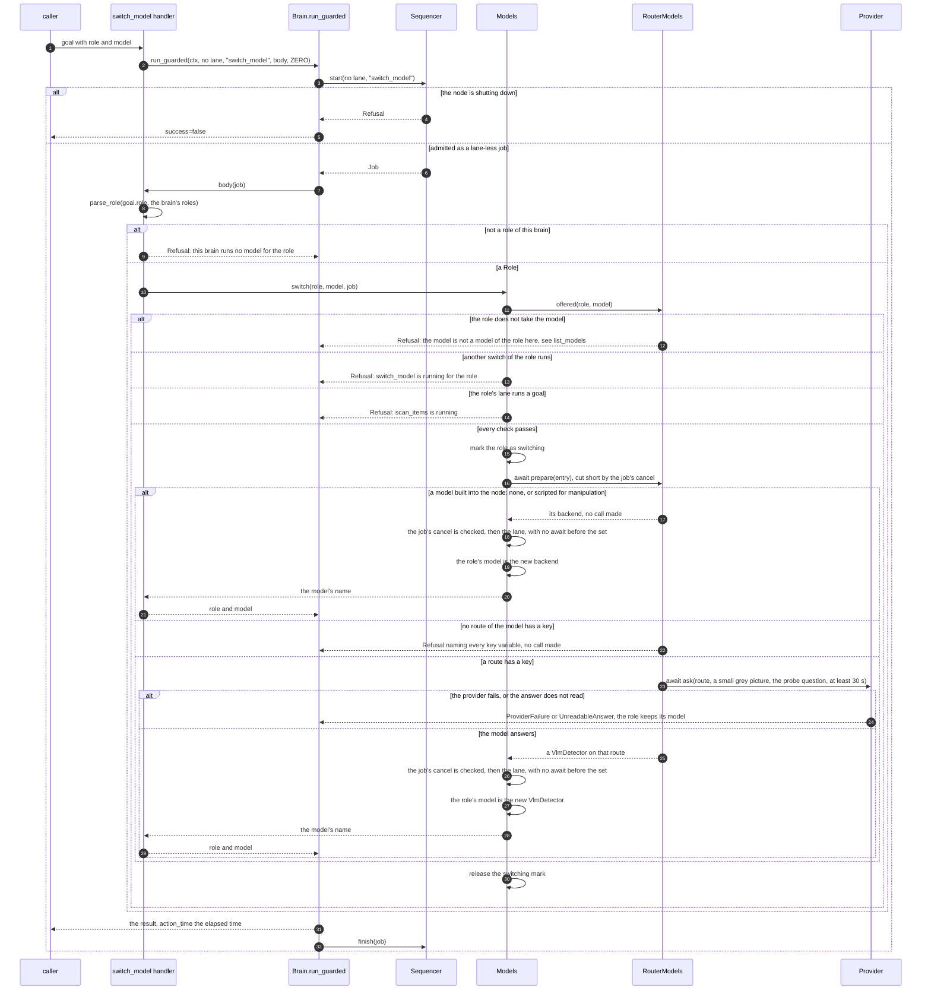
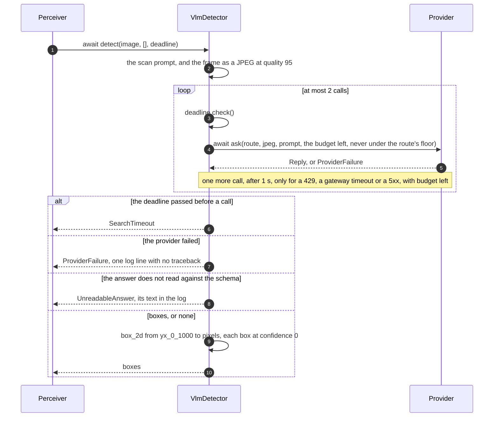

# vlm_router_brain

A brain whose models are hosted vision-language models, reached over the
network through [any-llm](https://github.com/mozilla-ai/any-llm). It serves
`item_perception:v1` and `item_manipulation:v1` as every brain does, and
`brain_model:v1`, which names the model of each role and switches one while
the brain runs. The contract rules, the robot, the camera geometry and the
goal loops are [brain_core](https://github.com/Peppy-bot/public-peppy-libs/tree/main/brain_core)'s;
this node brings the catalog of models, the detector that asks them, and
the keys.

It needs the network and a key, and no GPU.

## The catalog

`src/vlm_router_brain/catalog.json` lists the models the brain can run.
Each has a name of the node's own, the one `get_model`, `list_models` and
`switch_model` use, and one or more routes: a provider and that provider's
model id, with the settings the model was tested with.

| Model | Roles | Route |
|---|---|---|
| `gemini-robotics-er-2-preview` | perception | `gemini:gemini-robotics-er-2-preview` |
| `gemini-4-argon` | perception | `openrouter:google/gemini-4-argon` |
| `claude-opus-5.5` | perception | `openrouter:anthropic/claude-opus-5.5` |
| `gpt-6-astra` | perception | `openrouter:openai/gpt-6-astra` |

Every route asks for `reasoning_effort: "medium"`, and a call never gets
less than 10 s. A model is in the catalog once it returned correct boxes for
a Waldo chest frame through the node's prompt and schema: one question, "Find
the mustard bottle", one box at an IoU of 0.94 or more with the frame's
ground truth, in 3.3 to 4.9 s. Adding a model is an entry in this file: a
name, `"roles": ["perception"]`, `"coordinates": "yx_0_1000"` and its routes.
A catalog the node cannot read stops it at its start, naming the entry and
the field.

Both roles also accept `none`, the role's missing model: its goals are
refused naming it. No catalog model serves manipulation. Manipulation runs a
model built into the node: `scripted`, its default, or `none`, which refuses
`grab_item`, `drop_item` and `place_item` with
`no manipulation model: manipulation_model is 'none'`. A catalog model is
never named `none` or `scripted`.

## The scripted manipulator

`scripted` is brain_core's `ScriptedManipulator` on its `CentreProposer`, and
makes no model call. A `grab_item` takes the item's seen point lowered 2 cm
(a grab by pose takes the pose itself), checks with the backbone's
`check_arm_move` that the pre-grasp point 10 cm above, the grasp point and
the lifted point 10 cm above all plan, trying the gripper pointing down at 8
rolls (a grab by pose with an orientation tries that one alone), then opens,
reaches, closes with the goal's `max_effort` and lifts. It judges the hold
twice: from the close's `final_opening`, then from the first `limb_states`
snapshot captured after the lift, which it waits up to 1 s for; below 0.05
the grab fails, with `closed on nothing` or `slipped while lifting`.
`drop_item` opens the gripper where it is; `place_item` carries the item to
the pose and opens there. Every move goes through the backbone that the
`limb_motion` slot binds, and the `limb_state` slot gives the measured
openings, so the launcher binds both to the robot's backbone.

## Keys

The node reads the key of a route from its own environment and from nowhere
else: `GEMINI_API_KEY` for `gemini`, `OPENROUTER_API_KEY` for `openrouter`. A
model runs on the first of its routes whose key is set. A starting model with
no keyed route stops the node, and a switch to one is refused, both naming
the variables. No key is a parameter, and none is logged. A provider message
that holds the route's key shows `***` in its place.

`peppy stack launch` passes the launching shell's environment to the nodes it
starts on that machine, so a local launch reads the key the shell exports:

```sh
export GEMINI_API_KEY=...
peppy stack launch simulation_mcp --join openarm_sim:alpha --with alpha.vlm_router_brain
```

## What a search asks

A search asks one question with one picture: the colour frame at its full
resolution as a JPEG at quality 95. The question depends on the search: an
`identify_item` names one item ("Find the mustard bottle"), and `scan_items`,
or an `identify_item` with an empty description, asks for every object on
the table in the model's own words. Each answer is asked for, and read
against, one schema:

```json
{"boxes": [{"label": "the mustard bottle", "box_2d": [462, 312, 630, 382]}]}
```

`box_2d` is `[y_min, x_min, y_max, x_max]` normalised to 0-1000, and
`{"boxes": []}` means nothing asked for is visible. An answer of another shape
fails the search with `the model's answer could not be read`, and its text
goes to the log. A hosted model gives no confidence, so every item reports 0.

## Every search keeps a deadline

`timeout_s` is the search's budget, 10 s when zero. A call gets the budget
left, never under 10 s. A call that comes back with a 429, a gateway timeout
or a 5xx is asked again once, after 1 s, when the budget has room for the
wait. Any other failure, a lost connection among them, fails the search with
`<model> failed: <class>: <message>`, and the log keeps one line with no
traceback. A search whose budget is gone before a call is refused with `the
search did not finish within <budget> s`. Each call logs its route, its
tokens and its latency.

## Switching a model

`switch_model {role: "perception", model: "claude-opus-5.5"}` makes that
model the perception model. The node asks the model once, a small grey
picture and a question whose answer is `{"boxes": []}`, and the switch fails
with the provider's message when the model cannot be reached or its answer
does not read; the role then keeps its model. A switch is refused while a
goal of its role runs, naming it, and while another switch of its role runs.
A goal never sees its model change. At the node's start the starting model
makes no call: the first search is its first call.

## How it works

brain_core's README draws the parts every brain shares, a goal from its
arrival to its result, and cancel, abort and shutdown. This node brings
`RouterModels`, its `ModelSource`, and `VlmDetector`, the perception model
of a catalog entry.

### switch_model



### scan_items, from the detector to the provider



## Parameters

| Parameter | Default | Meaning |
|---|---|---|
| `limbs` | required | Each arm with its gripper, `"left_arm:left_gripper,right_arm:right_gripper"` |
| `perception_model` | `gemini-robotics-er-2-preview` | A catalog model that serves perception, or `none` |
| `manipulation_model` | `scripted` | `scripted` or `none` |
| `camera_name` | required | The camera the brain looks through, as the robot's `camera_mounts` names it |

## Tests

`uv run --locked --with pytest pytest` runs the suite with no network and no
key: the catalog, the keys, the any-llm adapter against any-llm's own
exception classes, the parser, the detector and the switch against a scripted
provider, and the whole node over the wire under the generated harness, its
camera and backbone mocked: a search, a switch, and the scripted grab from
the identified item to the held flag.
